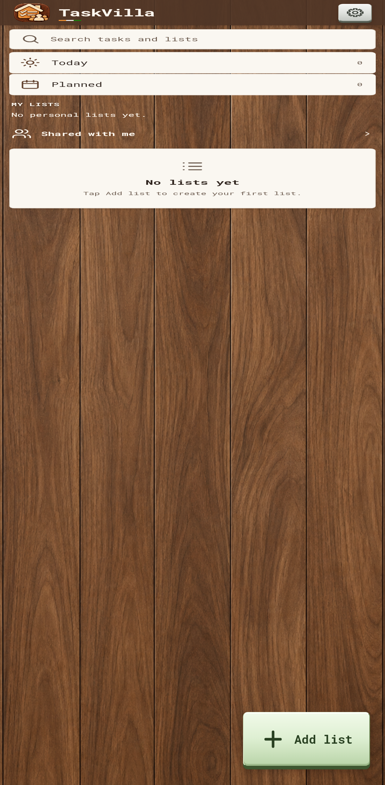

# TaskVilla

Android application. Current version: 0.24.0.

[Download APK](https://github.com/aniruddhaKol/taskvilla/releases/tag/v0.24.0)



## Layout

- `android/`: Java WebView shell, SQLite integration, packaged UI and versioned APKs.
- `web-preview/`: browser UI preview.
- `docs/`: sharing requirements and supporting documentation.
- `previews/`: app icon.

## Build

Requires Android SDK platform 36, build-tools 36.0.0 and a compatible JDK. Set `JAVA_HOME` locally. Signing configuration comes from environment variables: `SIGNING_KEYSTORE`, `SIGNING_ALIAS`, `SIGNING_STORE_PASSWORD` and `SIGNING_KEY_PASSWORD`. Use the original signing key for compatible updates. Keys and credentials are excluded from the repository. Run:

```powershell
./android/build.ps1
```

## Application identity

The installed package is `app.adc.taskvilla`. Sharing and email OTP flows are planned; this review build stores data locally and does not provide server synchronization.

Original APKs are preserved unchanged. The existing signed APK is available from the Releases page. Third-party font and data-provider notices remain with the source.

## Current review release

Version 0.24.0 (versionCode 24) improves editable-field focus outlines and keyboard viewport handling; it also includes the enlarged Settings gear from 0.23.0. See [release notes](docs/releases/v0.24.0.md) for verification and known limitations. Real Android keyboard validation remains incomplete because of emulator System UI instability.

File attachment is currently not working as expected; only filenames are recorded. Multiple files (10 MB each, proposed maximum 10), a limit notice and file sharing are [recorded for the next release](docs/taskvilla-next-release.md), not implemented here.

Author: **Aniruddha DuttaChowdhury** · Developer brand: **ADChowdhury**.


## License

Copyright © 2026 Aniruddha DuttaChowdhury.

Original project material is licensed under the **PolyForm Noncommercial License 1.0.0**. Personal, academic, research, educational and other qualifying noncommercial uses, modifications and redistribution are permitted in accordance with its terms. Commercial uses outside those permissions require separate authorization from the copyright holder.

Anyone redistributing covered software, including within another application, must pass along the license terms or their URL and all applicable Required Notices identifying the original author, project and source repository. This license does not require publication of the modified application's source code.

For complete terms, see [LICENSE.md](LICENSE.md). Third-party software, libraries, fonts, data and artwork remain subject to their respective licenses; see [third-party notices and unresolved permissions](THIRD-PARTY-NOTICES.md).

### Redistribution attribution example

For an application derived from `taskvilla`, accompany the distributed software with the license terms or their URL and these notices, for example in licensing documents or an attribution file:

```text
Based on: taskvilla
Required Notice: Copyright © 2026 Aniruddha DuttaChowdhury.
Required Notice: Original Author: Aniruddha DuttaChowdhury.
Required Notice: Original Project: taskvilla.
Required Notice: Original Source: https://github.com/aniruddhaKol/taskvilla
License: PolyForm Noncommercial License 1.0.0
License terms: https://polyformproject.org/licenses/noncommercial/1.0.0
```

An About screen acknowledgment is encouraged. The standard license does not impose separate app-store attribution or UI-branding requirements, or require public disclosure of modified source code.
