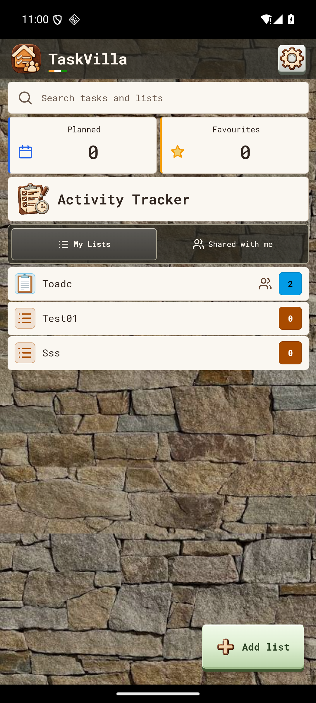
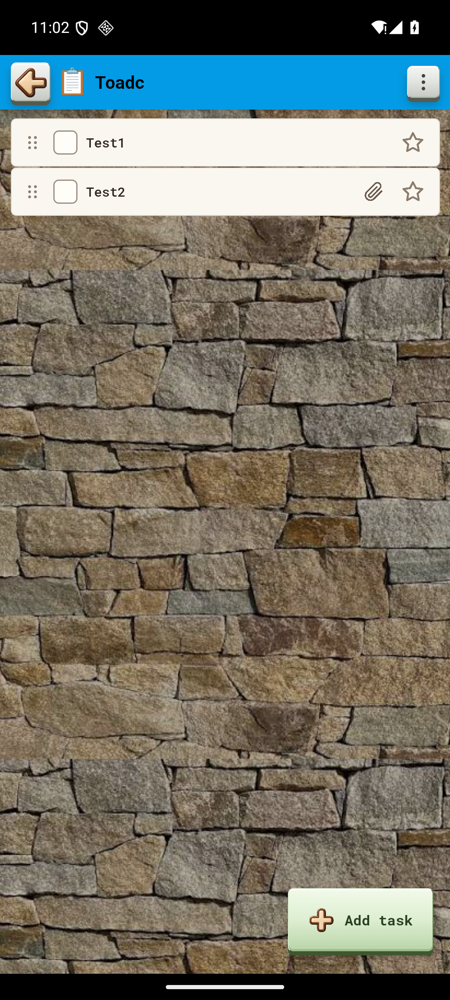
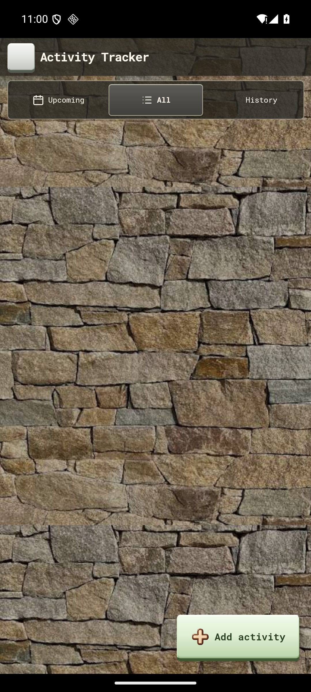
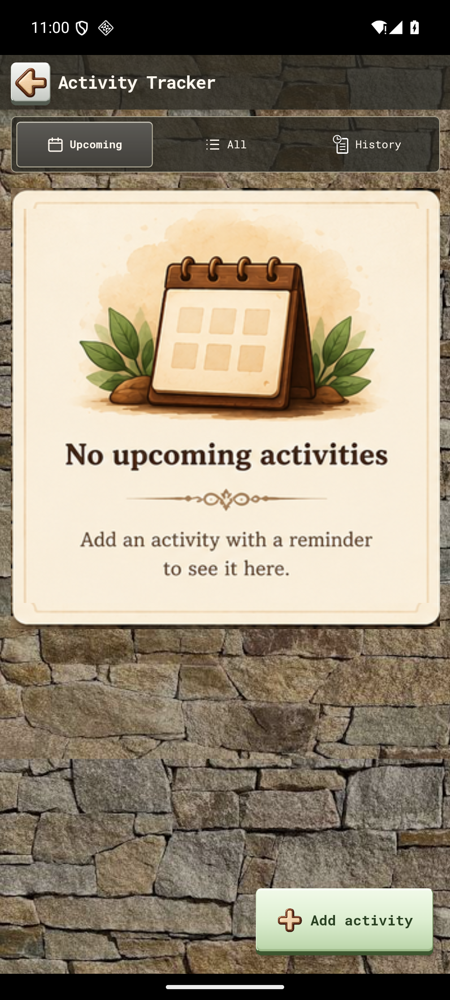
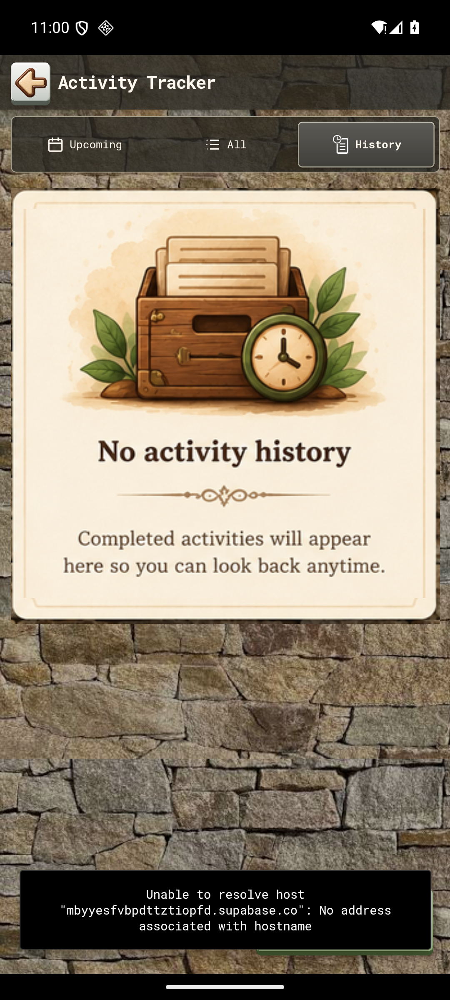

# TaskVilla

Android task lists, shared tasks and personal Activity Tracker by **Aniruddha DuttaChowdhury** (ADChowdhury).

Current release: **v0.58.22** (versionCode 98). Package: `app.adc.taskvilla`.

[Download APK](https://github.com/aniruddhaKol/TaskVilla/releases/tag/v0.58.22)

## Screenshots

Fresh screenshots captured from TaskVilla v0.58.22 on the Android emulator, 3 November 2026.

| Home | Tasks | Task details |
| --- | --- | --- |
|  |  |  |

| Activities — All | Activities — Upcoming | Activities — History |
| --- | --- | --- |
|  |  |  |

## Source layout

- `android/`: Java WebView shell, SQLite persistence, authentication/sync integration and packaged UI.
- `web-preview/`: browser UI preview.
- `taskvilla-api-contract/`: provider-neutral API contract, JSON Schemas, SQL migrations and API documentation.
- `supabase/functions/`: TaskVilla cloud attachment Edge Function source. Database functions, RLS, indexes and grants are retained in the SQL migrations.
- `docs/releases/`: release notes.

Tasks work locally; Supabase provides email OTP/session handling, sync and sharing. Activity Tracker and favourites are personal. Cloud attachments use the connected Google Drive or Dropbox account.

## Build

Requires Android SDK platform 36/build-tools 36.0.0 and a compatible JDK. Set `JAVA_HOME`, `SIGNING_KEYSTORE`, `SIGNING_ALIAS`, `SIGNING_STORE_PASSWORD` and `SIGNING_KEY_PASSWORD`, then run `./android/build.ps1`. Keep the original signing key for compatible updates. The published APK was copied from the existing signed local build without rebuilding.

## Backend

SQL source is in `supabase/migrations/`; the attachment gateway is `supabase/functions/taskvilla-attachments/index.ts`. Connector credentials, service keys, encryption keys, session tokens and signing material are not committed. Configure required secrets in Supabase's server-side environment, as referenced by the function source. Do not put provider client secrets in Android code.

Open `web-preview/index.html` for the UI preview. See [latest release notes](docs/releases/v0.58.22.md). Third-party attribution remains with the assets and in THIRD-PARTY-NOTICES.md.

Backend deployment notes: [docs/backend](docs/backend/supabase-deployment.md). Postman: [supabase/tests/postman](supabase/tests/postman/). The root API contract is canonical; Android reads `api-config.xml`, not the duplicate contract assets. `web-preview/` is the master UI in the Git checkout; `android/assets/ui/` is packaged UI. The working folder currently uses `ui/` and `android-taskvilla/assets/ui/`; these working assets were left in place.
