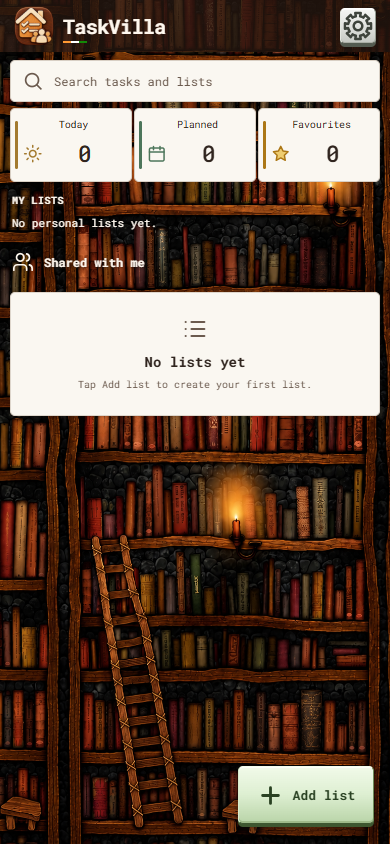

# TaskVilla

Android application. Current code and review APK: 0.47.0.

[Download current review APK](https://github.com/aniruddhaKol/TaskVilla/raw/refs/heads/main/android/releases/v0.47.0/taskvilla-v0.47.0.apk)

Latest published release: [v0.47.0](https://github.com/aniruddhaKol/TaskVilla/releases/tag/v0.47.0).



## Layout

- `android/`: Java WebView shell, SQLite integration, packaged UI and versioned APKs.
- `web-preview/`: browser UI preview.
- `docs/`: sharing requirements and supporting documentation.
- `previews/`: app icon.

## Build

Requires Android SDK platform 36, build-tools 36.0.0 and a compatible JDK. Set `JAVA_HOME` locally. Signing configuration comes from environment variables: `SIGNING_KEYSTORE`, `SIGNING_ALIAS`, `SIGNING_STORE_PASSWORD` and `SIGNING_KEY_PASSWORD`. Use the original signing key for compatible updates. Keys and credentials are excluded from the repository. Run:

```powershell
./android/build.ps1
```

## Application identity

The installed package is `app.adc.taskvilla`. Sharing and email OTP flows are planned; this review build stores data locally and does not provide server synchronization.

Original APKs are preserved unchanged. The existing signed APK is available from the Releases page. Third-party font and data-provider notices remain with the source.

## Current review release

Version 0.47.0 (versionCode 47) matches SMSAnalyzer's Settings theme grid: Wood and BookShelves on the first row; Brick and Stone on the second. Saved themes and other features are preserved. See [release notes](docs/releases/v0.47.0.md).

This publication reuses the existing signed APK and source bundle. No rebuild, tests or phone installation were performed during publication.

Task/list creation and editing protect unsaved changes with Discard/Save. Tasks support up to 10 private attachment copies, each at most 10 MB, newest first, with confirmed removal and individual file sharing. Matching size and CRC32 block duplicates within the same task only; the user-facing notice is “Same file already attached”. The same file can be attached to another task. After successful SQLite persistence, task/list deletion removes unreferenced private copies while keeping other tasks and active drafts; device originals are retained. Export format 2 includes attachment metadata, not file bytes. Dates use an explicit native picker and dd-MMM-yyyy display.

Browser and targeted native component/dialog checks are documented per version. Full real-IME and picker-to-recipient handoff coverage remain incomplete. Server-backed list-sharing tests remain deferred; no backend, email OTP or network synchronization is implemented. Fresh installs start empty. The screenshot uses synthetic review fixtures only.

Author: **Aniruddha DuttaChowdhury** · Developer brand: **ADChowdhury**.


## License

Copyright © 2026 Aniruddha DuttaChowdhury.

Original project material is licensed under the **PolyForm Noncommercial License 1.0.0**. Personal, academic, research, educational and other qualifying noncommercial uses, modifications and redistribution are permitted in accordance with its terms. Commercial uses outside those permissions require separate authorization from the copyright holder.

Anyone redistributing covered software, including within another application, must pass along the license terms or their URL and all applicable Required Notices identifying the original author, project and source repository. This license does not require publication of the modified application's source code.

For complete terms, see [LICENSE.md](LICENSE.md). Third-party software, libraries, fonts, data and artwork remain subject to their respective licenses; see [third-party notices and unresolved permissions](THIRD-PARTY-NOTICES.md).

### Redistribution attribution example

For an application derived from `taskvilla`, accompany the distributed software with the license terms or their URL and these notices, for example in licensing documents or an attribution file:

```text
Based on: taskvilla
Required Notice: Copyright © 2026 Aniruddha DuttaChowdhury.
Required Notice: Original Author: Aniruddha DuttaChowdhury.
Required Notice: Original Project: taskvilla.
Required Notice: Original Source: https://github.com/aniruddhaKol/TaskVilla
License: PolyForm Noncommercial License 1.0.0
License terms: https://polyformproject.org/licenses/noncommercial/1.0.0
```

An About screen acknowledgment is encouraged. The standard license does not impose separate app-store attribution or UI-branding requirements, or require public disclosure of modified source code.
